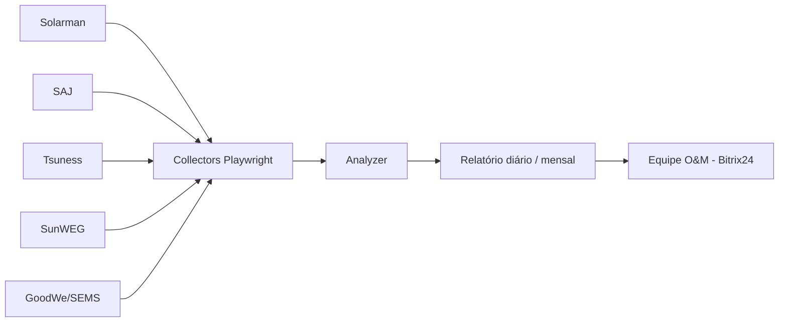

# Robô de Monitoramento de Usinas Solares

<!-- resumo: Robô em TypeScript + Playwright que coleta diariamente a geração de 30+ usinas em 5 portais de fabricantes e gera o relatório de O&M. -->
<!-- stack: TypeScript, Node.js, Playwright, node-cron, Supabase, Winston, IA generativa -->
<!-- status: Em produção -->

> Desenvolvido na **J3 Energia** para a rotina de Operação e Manutenção (O&M).

## O problema

Todo dia era preciso entrar manualmente em cada portal de fabricante, conferir usina por usina e montar a mensagem para a equipe.

## O que o sistema faz

- **Coletores por plataforma** com uma classe base comum: Solarman, SAJ, Tsuness, SunWEG e GoodWe (SEMS Portal)
- Sessões persistentes do navegador (login manual uma única vez, sem senhas no código)
- **Analisador** que identifica usinas offline, com alerta ou com geração abaixo do esperado
- **Relatórios** diários e fechamento mensal de geração (kWh) exportados em CSV
- Agendamento com `node-cron` e logs estruturados com Winston
- Módulo extra: **coleta do ponto dos colaboradores no Bitrix24** (Timeman) por dia ou período
- Skill de IA complementar com as regras de negócio do relatório: só libera a mensagem com 100% das usinas verificadas e dá detalhamento completo às usinas prioritárias

## Arquitetura

## Tecnologias

TypeScript · Node.js · Playwright · node-cron · Supabase · Winston · IA generativa

## Competências demonstradas

Web scraping · Automação com Playwright · Node.js/TypeScript · Arquitetura orientada a coletores · O&M solar

## Links

- Repositório: privado (código disponível sob solicitação)
- Demonstração / capturas de tela: `[adicionar]`
