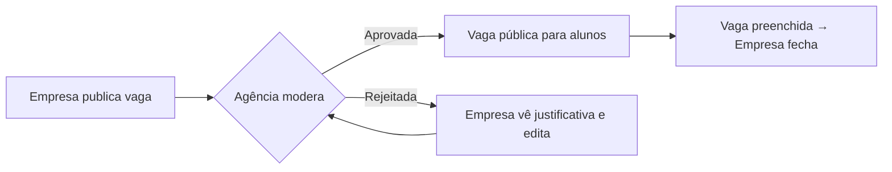

# Sistema de Gestão de Estágios — IFF

<!-- resumo: Plataforma web que centraliza o processo de estágio da Agência de Oportunidades do IFF (TCC). -->
<!-- stack: Engenharia de Software, UML, Casos de Uso, LaTeX -->
<!-- status: Em desenvolvimento (TCC) -->

> Trabalho de Conclusão de Curso — Bacharelado em Sistemas de Informação, Instituto Federal Fluminense (Campus Itaperuna).

## O problema

A Agência de Oportunidades do IFF gerencia os estágios dos alunos com planilhas, arquivos espalhados entre setores, e-mail e telefone. Isso gera:

- **Informação descentralizada**: para saber a situação de um estágio é preciso consultar várias fontes;
- **Comunicação fragmentada** entre aluno, empresa e instituição, sem histórico rastreável;
- **Riscos operacionais**: redigitação manual, extravio de documentos e erros humanos;
- **Ausência de indicadores**: não há como extrair estatísticas confiáveis de empregabilidade para prestação de contas e planejamento.

## A solução

Um sistema que acompanha o **ciclo de vida completo do estágio**, da publicação da vaga até a emissão da Declaração Final, com três perfis de acesso:

| Ator | Principais funcionalidades |
|---|---|
| **Aluno** | Consulta vagas, submete a formalização do estágio (TCE, PAE), acompanha o status do processo |
| **Empresa** | Publica vagas de estágio/emprego (título, modalidade, remuneração, carga horária, requisitos, cursos elegíveis), fecha vagas preenchidas, reenvia anúncios rejeitados |
| **Funcionário da Agência** | Modera vagas (aprovar/rejeitar com justificativa), analisa formalizações, gerencia processos e emite a Declaração Final |

### Fluxo de uma vaga

## O que foi produzido

- Levantamento de requisitos e análise do processo atual da Agência
- **Especificação de casos de uso** (fluxo principal, alternativos e de exceção), ex.: `UC-FUN-01 Gerenciar Processos de Estágio`, `Gerenciar Vagas`
- Modelagem UML
- Fundamentação teórica baseada na Lei nº 11.788/2008 (Lei do Estágio), em Sistemas de Informação Gerenciais (Laudon & Laudon) e em gestão da informação em instituições de ensino
- Documentação completa em **LaTeX** (normas ABNT)

## Tecnologias

<!-- Preencha com a stack real do sistema -->
- Front-end: `[preencher]`
- Back-end: `[preencher]`
- Banco de dados: `[preencher]`
- Documentação: LaTeX, UML

## Competências demonstradas

Levantamento e análise de requisitos · Modelagem de processos · Engenharia de Software · Documentação técnica · Pesquisa acadêmica

## Links

- Repositório do código: `[preencher]`
- Monografia (PDF): `[preencher após a defesa]`
